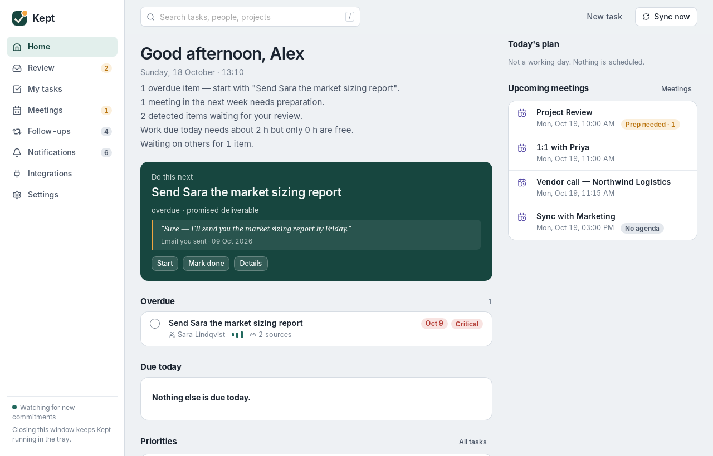
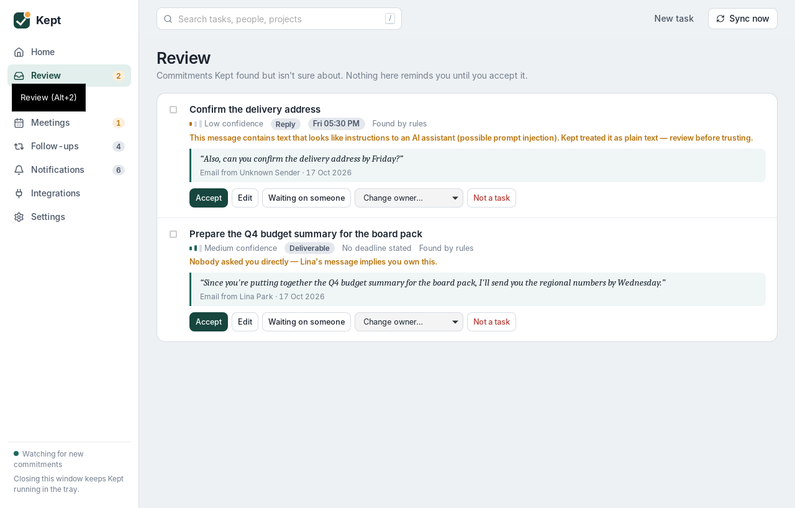
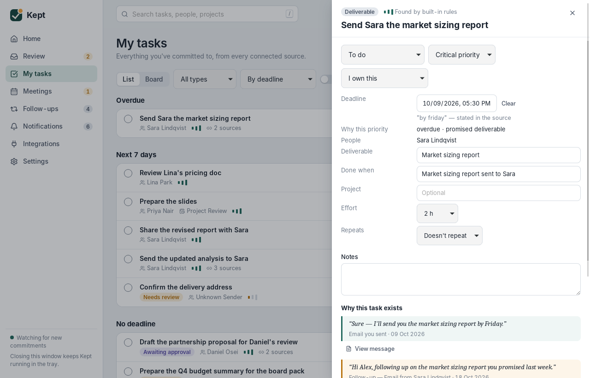
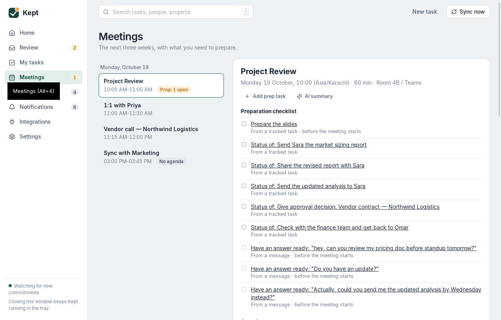

# Kept

**A personal AI work assistant for Windows that remembers what you promised.**

Kept reads the work accounts you choose (Gmail, Google Calendar, Microsoft 365 / Outlook, Teams, Slack, Jira, Asana, Todoist, Linear, Google Drive, OneDrive & SharePoint), finds the commitments hidden in your conversations, and turns them into tasks. That includes explicit requests, promises you made ("I'll send it tomorrow"), implicit ownership, approvals people are waiting on, and follow-ups you owe. It prepares you for meetings and reminds you before anything slips, without spamming you. It runs quietly in the system tray, on your own PC.

| Every task shows *why* it exists | Uncertain items wait for your review | Meetings come with what to prepare |
|---|---|---|
| The quoted sentence, who said it and when, with a link to the original | Accept, edit, merge, change owner, or reject | Linked tasks, promises to attendees and related threads; suggestions are labelled as such |

## Status: v0.3.0

**Integrations (all implemented):**

| Area | Services |
|---|---|
| Email and calendar | Gmail, Google Calendar, Microsoft 365 / Outlook mail and calendar |
| Chat | Slack, Microsoft Teams |
| Task tools | Jira, Asana, Todoist, Linear |
| Documents | Google Drive, OneDrive & SharePoint |
| Files | .eml / .ics import |

**Status:**

- Gmail and Google Calendar are **live-tested on Windows**.
- The other services pass automated tests against mocks of their documented APIs and still need a live check (see [docs/INTEGRATIONS.md](docs/INTEGRATIONS.md)).
- 63 automated tests pass.

**Core features:**

- desktop app with tray, background agent and autostart;
- commitment detection with built-in rules or any AI provider (schema-validated, injection-resistant);
- review queue;
- task lifecycle with evidence and undo;
- cross-source dedup;
- meeting briefings and the daily plan;
- smart notifications;
- export, backup and delete.

Details are in [docs/LIMITATIONS.md](docs/LIMITATIONS.md). Measured numbers are in [docs/TESTING.md](docs/TESTING.md).

## Quick start (Windows 10/11)

```powershell
# 1. unzip to C:\dev\kept, then in PowerShell:
cd C:\dev\kept
Set-ExecutionPolicy -Scope Process Bypass
.\scripts\setup-windows.ps1        # installs C++ Build Tools, Rust, Node.js, WebView2 (once)
# 2. open a NEW PowerShell window
cd C:\dev\kept
.\scripts\build-windows.ps1        # tests + builds target\release\bundle\nsis\Kept_0.3.0_x64-setup.exe
# 3. double-click the installer
```

Alternatively, upload the folder to a private GitHub repository and run **Actions → Build Windows installer**. You'll get the `.exe` and `.msi` without installing anything locally.

To try it in development mode: `npm install`, then `npm run app:dev`. On first launch choose **Explore with sample data**.

The full guide, including Google, Microsoft and AI setup, is in [docs/SETUP.md](docs/SETUP.md).

## How it works

```
Gmail / Outlook / Calendars ──► connectors (OAuth+PKCE, incremental sync)
                                     │
                                     ▼
                      SQLite (bounded excerpts, retention)
                                     │
             ┌───────────────────────┴───────────────────────┐
             ▼                                               ▼
  AI extractor (Claude / OpenAI / local)            Rules extractor (offline)
  validated: evidence must be quoted verbatim        fallback + no-AI mode
             └───────────────────────┬───────────────────────┘
                                     ▼
     tasks · deadlines (explicit / inferred / suggested / confirmed) · evidence
     dedup & merge · waiting-for · approvals · meeting prep · daily plan
                                     ▼
             notification engine ──► Windows toasts + in-app centre
```

One small native process, written in Rust with Tauri 2. The React UI is created when you open the window and destroyed when you close it, so the background agent stays light. More detail: [docs/ARCHITECTURE.md](docs/ARCHITECTURE.md).

## Project layout

```
kept/
├─ crates/kept-core/        Rust library: everything except UI (testable on any OS)
│  ├─ src/                  agent, connectors, extract, ai, dates, tasks, notify, meetings, planner…
│  ├─ migrations/           SQL schema
│  ├─ tests/                pipeline, mocked integration, extraction evaluation
│  └─ examples/seed.rs      create a demo database
├─ src-tauri/               Windows desktop shell (tray, window, IPC, Credential Manager)
├─ ui/                      React + TypeScript interface
├─ sample-data/eval/        labelled synthetic messages (dev + hold-out)
├─ scripts/                 setup-windows.ps1, build-windows.ps1, dev.ps1
├─ .github/workflows/       CI + Windows installer build
└─ docs/                    setup, architecture, security, integrations, testing, limitations, sharing, troubleshooting
```

## Documentation

| | |
|---|---|
| [USER-GUIDE.md](docs/USER-GUIDE.md) | For people who install Kept: connecting accounts and everyday use |
| [ADMIN-GUIDE.md](docs/ADMIN-GUIDE.md) | For company IT: set up once and share a settings file |
| [SETUP.md](docs/SETUP.md) | For you as the developer: build, run, register apps, add AI |
| [ARCHITECTURE.md](docs/ARCHITECTURE.md) | Stack choices, process model, data flow, sync, database |
| [SECURITY.md](docs/SECURITY.md) | What's accessed and stored, what goes to AI, injection defences, threat model |
| [INTEGRATIONS.md](docs/INTEGRATIONS.md) | Every integration: how it signs in, what it reads, test status |
| [TESTING.md](docs/TESTING.md) | Test suites, measured extraction quality, what wasn't tested |
| [LIMITATIONS.md](docs/LIMITATIONS.md) | Known gaps and next steps |
| [SHARING.md](docs/SHARING.md) | Giving Kept to others, code signing, updates, backup/restore |
| [TROUBLESHOOTING.md](docs/TROUBLESHOOTING.md) | Common problems and fixes |

## Commands

| Command | What it does |
|---|---|
| `npm run app:dev` | Run the app with live reload |
| `npm run app:build` | Build installers (same as `npm run tauri build`) |
| `cargo test -p kept-core` | Run all Rust tests |
| `npm run typecheck` | Type-check the UI |
| `cargo run -p kept-core --example seed -- <dir>` | Create a demo database (developer tool) |

## License

MIT. See [LICENSE](LICENSE).

## Screenshots

These were captured from the real app running on the sample workspace. The development machine was Linux, so fonts differ slightly from Windows.





